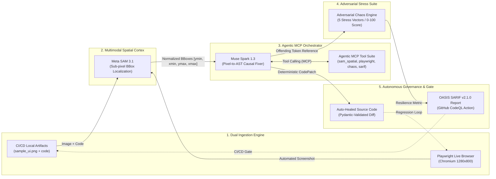

# ⚡ QA-Swarm: Autonomous Multimodal QA & Healing Engine

[](https://api.meta.ai/)
[](https://api.meta.ai/)
[](https://modelcontextprotocol.io/)
[](https://docs.pydantic.dev/)
[](https://playwright.dev/)
[](https://sarifweb.azurewebsites.net/)
[](LICENSE)

---

## 📌 Executive Summary

**QA-Swarm** is an enterprise-grade, closed-loop autonomous quality engineering system bridging **multimodal computer vision** with **deterministic source code remediation**. 

Traditional visual regression tools merely capture pixel differences without code semantics, while static linters inspect code without visual awareness of real-world browser rendering. **QA-Swarm** unites both worlds through a bidirectional agent swarm powered by **Meta AI's next-generation models**:

1. **Meta SAM 3.1 (`sam-3.1` Spatial Cortex):** Performs sub-pixel visual segmentation, extracting localized layout overflow anomalies and parsing coordinate tokens `<|box;x1=...;y1=...;x2=...;y2=...;w=...;h=...|>` into normalized coordinates `[ymin, xmin, ymax, xmax]`.
2. **Meta Muse Spark 1.3 (`muse-spark-1.3` Causal Correlator & Code Healer):** Reasons across the visual bounding boxes and component AST to identify the exact offending code token and line number. Orchestrates tools via **Model Context Protocol (MCP)** and synthesizes Pydantic-validated surgical patches (`difflib` unified diffs).
3. **Adversarial Chaos Engine:** Evaluates defensive resilience across 5 adversarial vectors (buffer overflow, bidirectional RTL Unicode, type mutation, syntax breakout, and concurrency event storms).
4. **CI/CD Governance & OASIS SARIF v2.1.0 Gate:** Generates standardized SARIF v2.1.0 reports for native **GitHub Code Scanning / CodeQL** integration, determining an objective Health Score (0–100) and automated deployment gate verdicts.

---

## 🏛️ Closed-Loop System Architecture

The following diagram illustrates the closed-loop autonomous pipeline from dual ingestion through Meta AI multimodal reasoning to automated code healing and CI/CD gate validation:



---

## 🌟 Key Capabilities & Enterprise Features

| Feature | Description | Architecture Component |
| :--- | :--- | :--- |
| **Dual Ingestion Mode** | Supports both preloaded CI/CD artifacts and on-the-fly live web URL inspection via headless Chromium. | `core/browser.py` & `app/main.py` |
| **Spatial Anomaly Cortex** | Sub-pixel visual segmentation using Meta SAM 3.1 with automated coordinate normalization and bounding box clamping. | `core/vision.py` & `core/client.py` |
| **Causal Pixel-to-Code Mapping** | Bridges pixel coordinates with source code AST, mapping visual overflow to specific lines and tokens. | `core/correlator.py` |
| **Surgical Code Healing** | Generates verified replacement patches (`width: 120px` ➔ `width: 100%`) with unified diff visualization and direct download. | `core/analyzer.py` |
| **Live Agentic MCP Trace** | Inspectable JSON telemetry displaying tool invocations (`sam_spatial_scanner`, `muse_spark_causal_correlator`, etc.) with latencies and status. | `app/main.py` (Expander) |
| **Adversarial Chaos Suite** | Evaluates code resilience across 5 adversarial stress vectors and calculates defensive scores (0–100). | `core/chaos.py` |
| **Playwright Test Synthesis** | Generates executable Python regression tests verified with Python's built-in AST parser (`ast.parse`). | `core/test_generator.py` |
| **OASIS SARIF v2.1.0 CI/CD** | Exports standardized SARIF reports directly consumable by GitHub Code Scanning (`github/codeql-action/upload-sarif@v3`). | `core/orchestrator.py` & `.github/workflows/` |
| **Intelligent Session Caching** | Zero-latency 0ms downloads and rerenders backed by `@st.cache_data` and SHA-256 payload hashing. | `app/main.py` |
| **Connection Pooling & Compression** | Reusable `requests.Session()` with keep-alive handshakes and in-memory Pillow image downscaling (`<=1280px`). | `core/client.py` |
| **Deterministic Offline Mode** | Full offline capability via `USE_MOCK=true` with benchmark fixtures, requiring zero external network calls. | `test_samples/mock_audit_result.json` |

---

## 🔬 Competitive Matrix

| Capability | QA-Swarm | Applitools / Percy | SonarQube / ESLint |
| :--- | :---: | :---: | :---: |
| **Visual Anomaly Detection** | ✅ **Yes (Meta SAM 3.1 BBoxes)** | ✅ Yes (DOM/Pixel diff) | ❌ No |
| **Causal Code Mapping** | ✅ **Yes (Pixel-to-Line AST Link)** | ❌ No (Visual only) | ❌ No (Static rules only) |
| **Automated Code Healing** | ✅ **Yes (Pydantic-Validated)** | ❌ No | ⚠️ Partial (Mechanical fixes) |
| **Live Browser Capture** | ✅ **Yes (Headless Chromium Ingestion)** | ⚠️ Plugin dependent | ❌ No |
| **Adversarial Chaos Engine** | ✅ **Yes (5 Attack Categories)** | ❌ No | ❌ No |
| **Agentic MCP Telemetry** | ✅ **Yes (Inspectable Execution Trace)** | ❌ No | ❌ No |
| **OASIS SARIF v2.1.0 Export** | ✅ **Yes (Native GitHub Actions)** | ❌ No | ⚠️ Plugin dependent |
| **Deterministic Offline Mode** | ✅ **Yes (`USE_MOCK=true`)** | ❌ No (SaaS cloud lock-in) | ✅ Yes (Local engine) |

---

## 🚀 Quickstart & Setup Guide

### 1. Prerequisites
- Python 3.11 or 3.12 installed.
- Git.

### 2. Virtual Environment & Dependencies
```bash
# Clone the repository
git clone https://github.com/meta-hackathon/qa-swarm.git
cd qa-swarm

# Create and activate virtual environment
python -m venv .venv

# On Windows (PowerShell):
.\.venv\Scripts\Activate.ps1

# On Linux / macOS:
source .venv/bin/activate

# Install essential dependencies:
pip install --upgrade pip
pip install -r requirements.txt

# Download required Chromium browser binaries:
playwright install chromium
```

### 3. Environment Variables Configuration
Copy the provided `.env.example` file to `.env`:
```bash
cp .env.example .env
```

Contents of `.env`:
```env
META_API_KEY=your_meta_api_key_here
META_BASE_URL=https://api.meta.ai/v1
USE_MOCK=false
```

> **Security Note:** `.env` is permanently excluded from version control via `.gitignore`. When `USE_MOCK=true` or if no `META_API_KEY` is provided, QA-Swarm runs transparently using local deterministic benchmarks.

---

## 💻 Execution Workflows

### Workflow A: Interactive Web Dashboard (Streamlit)
Launch the modern Dark DevTools dashboard:
```bash
streamlit run app/main.py
```
Open **`http://localhost:8501`** in your browser:
* **Demo & Archivos Locales Tab:** Preloaded with `sample_ui.png` and `broken_component.py`.
* **Playwright Live URL Tab:** Enter any web endpoint (e.g. `http://localhost:3000` or `https://example.com`) for live headless Chromium capture.
* Click **"⚡ Ejecutar Auditoría del Enjambre"** to trigger the multimodal swarm audit.
* Click **"✨ Download Patched File (Auto-Healed)"** for instant 0ms remediation download.
* Expand **"🧠 View Agentic MCP Execution Trace"** to inspect tool telemetry.

### Workflow B: Headless CI/CD Gate (CLI)
Run automated audits directly in CI/CD pipelines (GitHub Actions, GitLab CI, Jenkins):
```bash
python -m core.cli --ui test_samples/sample_ui.png --code test_samples/broken_component.py --output test_samples/qa_audit.sarif --allow-blocked
```

#### CLI Argument Reference

| Flag | Type | Default | Description |
| :--- | :---: | :--- | :--- |
| `--ui` | string | `test_samples/sample_ui.png` | Target UI screenshot image (PNG/JPG) |
| `--code` | string | `test_samples/broken_component.py` | Target component source code file |
| `--output` / `--sarif` | string | `test_samples/qa_audit.sarif` | Destination path for OASIS SARIF v2.1.0 report |
| `--mock` | boolean | `True` | Enables deterministic evaluation without remote network calls |
| `--no-mock` | flag | — | Disables mock mode and engages live Meta AI endpoints |
| `--allow-blocked` | flag | `False` | Forces exit code `0` even if verdict is `BLOCK_DEPLOYMENT` |

### Workflow C: GitHub Actions Integration
QA-Swarm includes a turnkey GitHub Actions workflow at [`.github/workflows/qa-swarm.yml`](.github/workflows/qa-swarm.yml):
```yaml
name: QA-Swarm Autonomous Multimodal Audit
on:
  push:
    branches: [ main ]
  pull_request:
    branches: [ main ]

jobs:
  audit:
    runs-on: ubuntu-latest
    steps:
      - uses: actions/checkout@v4
      - name: Set up Python
        uses: actions/setup-python@v5
        with:
          python-version: '3.11'
      - name: Install Dependencies
        run: |
          pip install -r requirements.txt
          playwright install --with-deps chromium
      - name: Run QA-Swarm Headless Audit
        run: |
          python -m core.cli --ui test_samples/sample_ui.png --code test_samples/broken_component.py --output test_samples/qa_audit.sarif --allow-blocked
      - name: Upload SARIF to GitHub Code Scanning
        uses: github/codeql-action/upload-sarif@v3
        with:
          sarif_file: test_samples/qa_audit.sarif
```

---

## 🧪 Comprehensive Test Suite

QA-Swarm maintains 100% test pass rate across 40 unit, integration, and UI smoke tests:

```bash
pytest tests/ -v
```

```text
============================= test session starts =============================
tests/test_analyzer.py::test_analyze_source_code_mock PASSED             [  2%]
tests/test_analyzer.py::test_generate_code_patch_schema PASSED           [  5%]
tests/test_analyzer.py::test_apply_patch_correctness PASSED              [  7%]
tests/test_analyzer.py::test_generate_diff_contains_markers PASSED       [ 10%]
tests/test_app.py::test_app_main_exists_and_is_valid_ast PASSED          [ 12%]
tests/test_app.py::test_app_main_contains_key_components PASSED          [ 15%]
tests/test_browser.py::test_capture_url_screenshot_empty_url_raises PASSED [ 17%]
tests/test_browser.py::test_capture_url_screenshot_with_data_url PASSED  [ 20%]
tests/test_browser.py::test_capture_url_screenshot_fallback_on_unreachable_host PASSED [ 22%]
tests/test_browser.py::test_capture_url_screenshot_invalid_host_raises_when_fallback_disabled PASSED [ 25%]
tests/test_chaos.py::test_generate_chaos_suite_returns_five_cases PASSED [ 27%]
tests/test_chaos.py::test_chaos_test_cases_pydantic_validation PASSED    [ 30%]
tests/test_chaos.py::test_chaos_stress_vectors_are_diverse PASSED        [ 32%]
tests/test_chaos.py::test_evaluate_resilience_score_range PASSED         [ 35%]
tests/test_correlator.py::test_correlate_single_defect_mock PASSED       [ 37%]
tests/test_correlator.py::test_correlate_all_defects_consistency PASSED  [ 40%]
tests/test_correlator.py::test_correlate_empty_code_graceful_fallback PASSED [ 42%]
tests/test_generator.py::test_generate_playwright_test_structure PASSED  [ 45%]
tests/test_generator.py::test_generated_test_is_valid_python_ast PASSED  [ 47%]
tests/test_generator.py::test_validate_test_syntax_detects_syntax_errors PASSED [ 50%]
tests/test_generator.py::test_save_generated_test_writes_file PASSED     [ 52%]
tests/test_orchestrator.py::test_calculate_health_score_scoring_logic PASSED [ 55%]
tests/test_orchestrator.py::test_export_to_sarif_schema_compliance PASSED [ 57%]
tests/test_orchestrator.py::test_run_full_audit_pipeline PASSED          [ 60%]
tests/test_orchestrator.py::test_cli_execution PASSED                    [ 62%]
tests/test_schemas.py::test_mock_audit_json_validity PASSED              [ 65%]
tests/test_schemas.py::test_client_run_audit_fallback PASSED             [ 67%]
tests/test_schemas.py::test_client_call_sam3_vision_fallback PASSED      [ 70%]
tests/test_schemas.py::test_client_call_muse_spark_correlation_fallback PASSED [ 72%]
tests/test_schemas.py::test_client_sam3_box_regex_parsing PASSED         [ 75%]
tests/test_schemas.py::test_swarm_audit_result_alias PASSED              [ 77%]
tests/test_schemas.py::test_optimize_and_encode_image_resizes_large_image PASSED [ 80%]
tests/test_schemas.py::test_client_connection_pool_session PASSED        [ 82%]
tests/test_ui_smoke.py::test_app_syntax_and_dependencies PASSED          [ 85%]
tests/test_ui_smoke.py::test_streamlit_apptest_initial_render PASSED     [ 87%]
tests/test_ui_smoke.py::test_orchestrator_ui_integration PASSED          [ 90%]
tests/test_ui_smoke.py::test_streamlit_caching_and_session_state_persistence PASSED [ 92%]
tests/test_vision.py::test_normalize_coordinates_clamping PASSED         [ 95%]
tests/test_vision.py::test_draw_bounding_boxes_creates_file PASSED       [ 97%]
tests/test_vision.py::test_inspect_ui_elements_mock PASSED               [100%]

============================= 40 passed in 10.67s =============================
```

---

## 📄 License

Licensed under the **MIT License** — see the [LICENSE](LICENSE) file for details.
Copyright (c) 2026 QA-Swarm Contributors.
